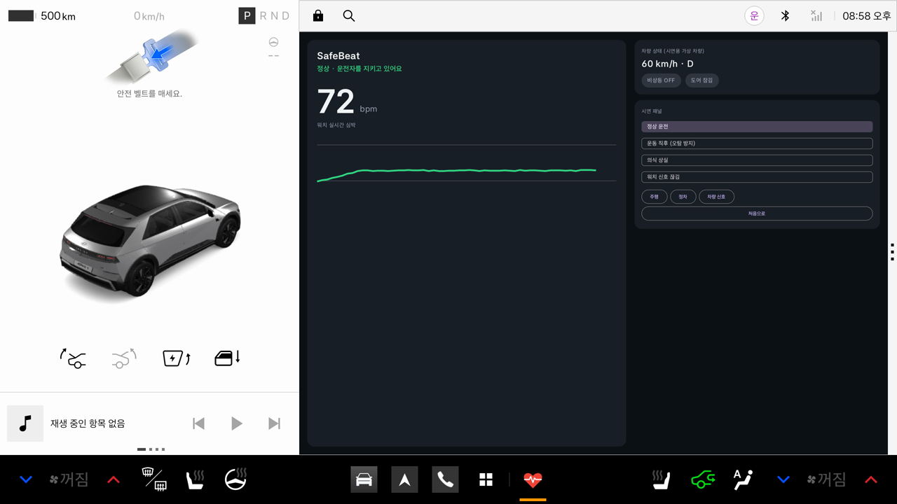
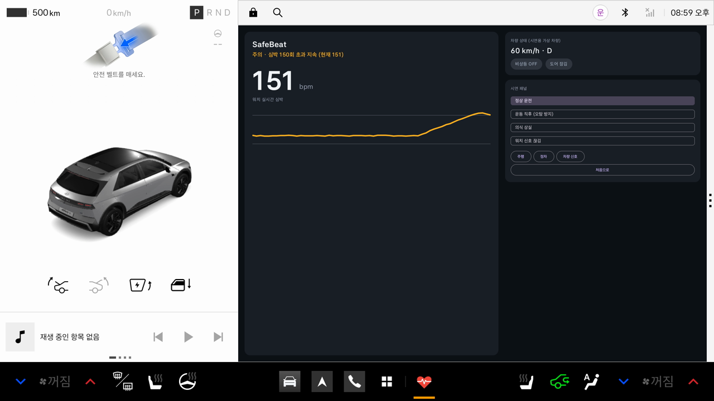
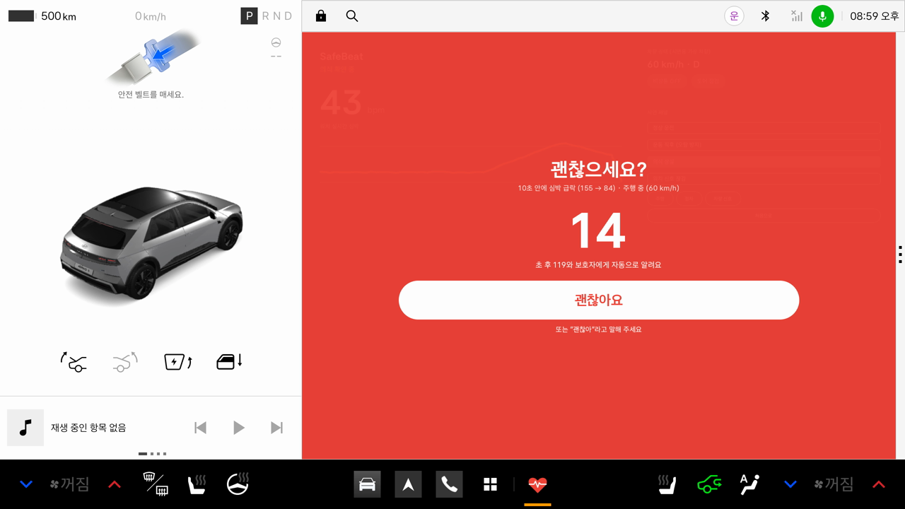
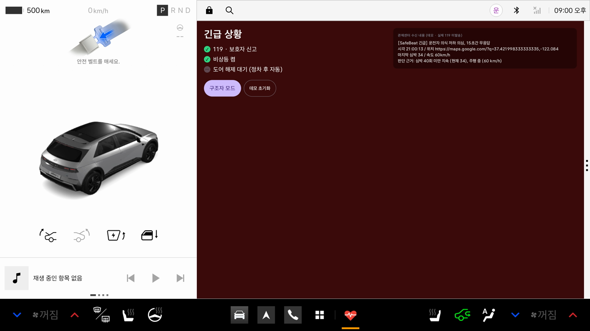
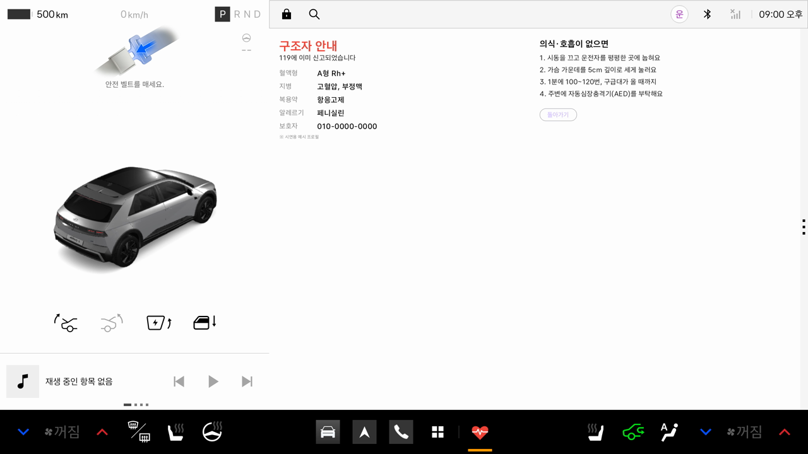

# SafeBeat — 에어백이 터지기 전에, 차가 먼저 알아차린다

**한 줄 소개:** 스마트워치 심박과 차량 주행 정보를 함께 보고 운전자의 의식 저하를 감지하는 Pleos Connect 차량용 안전 앱입니다. 의식 저하가 감지되면 15초 동안 음성과 화면으로 운전자에게 확인하고, 응답이 없으면 신고·비상등·구조 안내를 자동으로 실행합니다.

> 현대자동차그룹 차량용 앱 개발 공모전 출품작 (대학생 부문)

| 평상시 | 운동 직후 (오탐 방지) | 15초 의식 확인 |
|---|---|---|
|  |  |  |

| 긴급 조치 | 구조자 모드 |
|---|---|
|  |  |

*모든 화면은 Pleos Connect 에뮬레이터 v2.1.0에서 실제로 동작하는 화면입니다.*

---

## APK

- 위치: [`apk/개인참가_SafeBeat_release.apk`](apk/)
- 설치: `adb install apk/개인참가_SafeBeat_release.apk`
- release 빌드이며, 별도 키 설정 없이 바로 설치할 수 있도록 debug 키로 서명했습니다.

## 실행 방법

1. Android Studio에서 이 폴더를 엽니다 (`File > Open`).
2. Pleos Connect 에뮬레이터를 실행합니다.
   - System Image: `Pleos Connect v2.1.0 APIs` (API 34, arm64-v8a)
   - Cold boot, RAM 4GB 이상
3. `Run 'app'`을 누릅니다. 처음 실행할 때 마이크·위치·차량 속도 권한을 허용합니다.
4. 화면 오른쪽 **시연 패널**에서 시나리오를 바꿔 가며 확인합니다.

## 테스트 환경

| 항목 | 버전 |
|---|---|
| IDE | Android Studio Rabbit 1 (2026.2.1) |
| 에뮬레이터 | Pleos Connect Emulator 2.1.0 (API 34, arm64), macOS (Apple Silicon) |
| 언어·UI | Kotlin 2.0.21, Jetpack Compose |
| SDK | minSdk 28 / targetSdk 34 / compileSdk 35 |
| 필요한 설정 | 없음 (권한 허용만) |

## 시연 시나리오

시연 패널 버튼 또는 adb 명령(debug 빌드)으로 바꿀 수 있습니다.

| 시나리오 | 결과 |
|---|---|
| 정상 운전 | 심박 70대, "정상" |
| 운동 직후 | 심박 160 → **신고하지 않고 '주의·휴식 권유'만** (오탐 방지) |
| 의식 상실 | 심박 급락 → 빨간 화면 + 음성 "괜찮으세요?" → 15초 카운트다운 |
| └ 응답함 | "괜찮아"(음성) 또는 버튼 → 즉시 취소 |
| └ 무응답 | 보호자·관제센터 신고(데모), 비상등 ON, 정차 시 도어 해제, 구조자 모드 |
| 워치 신호 끊김 | 주행 중이면 의식 확인, 정차 중이면 주의 |

```bash
adb shell am broadcast -a com.safebeat.DEBUG --es scenario FAINT        # NORMAL / EXERCISE / FAINT / SIGNAL_LOSS
adb shell am broadcast -a com.safebeat.DEBUG --es drive false           # 정차
adb shell am broadcast -a com.safebeat.DEBUG --es reset true            # 처음으로
```

## 위험 판단 방식 (오탐 방지)

| 신호 | 점수 |
|---|---|
| 심박 40 미만 5초 지속 | +3 |
| 10초 안에 40회 이상 급락 | +2 |
| 워치 신호 10초 이상 끊김 | +2 |
| 심박 150 초과 5초 지속 | +1 |
| 위 항목이 있으면서 주행 중 | +1 |

합계 **3점 이상**이면 15초 의식 확인, 1~2점이면 주의(휴식 권유). 심박만 높은 경우(운동 직후)는 2점이라 신고하지 않습니다. 판단 로직은 `core/` 패키지의 순수 Kotlin으로 분리했고, 단위 테스트로 검증합니다(`./gradlew test`).

## 구조

| 폴더 | 역할 |
|---|---|
| `core/` | `RiskEngine`(위험 점수), `EmergencyCoordinator`(감시 → 주의 → 15초 확인 → 긴급). 안드로이드와 무관한 순수 Kotlin |
| `data/` | 심박 입력, 차량 신호(CarPropertyManager), 차량 제어, 음성(TTS/STT), 신고 |
| `ui/` | 대시보드, 15초 확인, 긴급, 구조자 모드 화면(Compose) |

## Pleos SDK 활용과 현재 구현 (솔직하게)

| 기능 | 현재 프로토타입 | Pleos 연동 계획 |
|---|---|---|
| 차량 속도·기어 | AAOS CarPropertyManager | Vehicle SDK |
| 음성 질문·응답 | Android TTS / SpeechRecognizer | TextToSpeech / SpeechToText SDK |
| 위치 | LocationManager | FusedLocation SDK |
| 최근접 응급실·쉼터 안내 | 예정 | NaviHelper SDK |
| 워치 심박 | 시뮬레이터 | Wear OS → 폰 → 서버 → 차량 |
| 119 신고 | 관제센터 화면 데모 (**실제 미발송**) | 보호자 알림 → 관제센터 확인 → 119 연계 |
| 비상등·도어 | 가상 차량 패널 (`VehicleControl` 인터페이스) | 제어 API 개방 시 구현체만 교체 |
